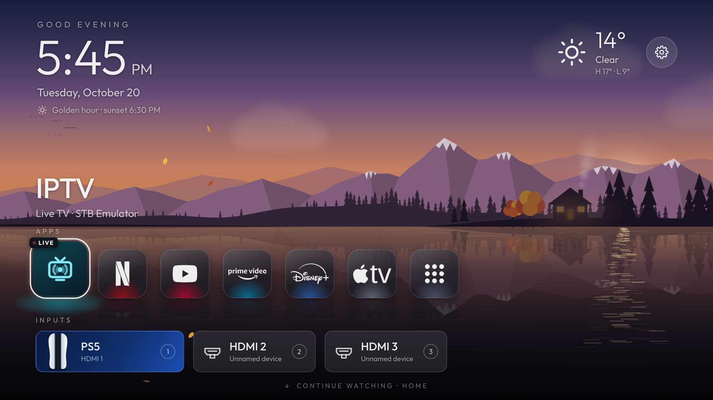
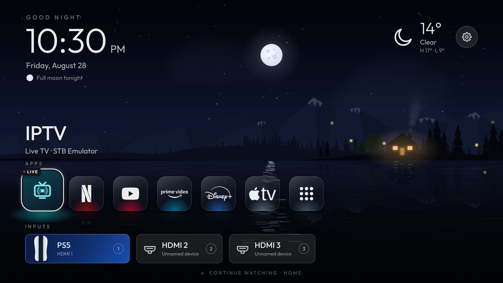
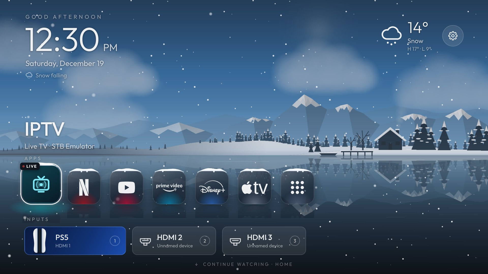
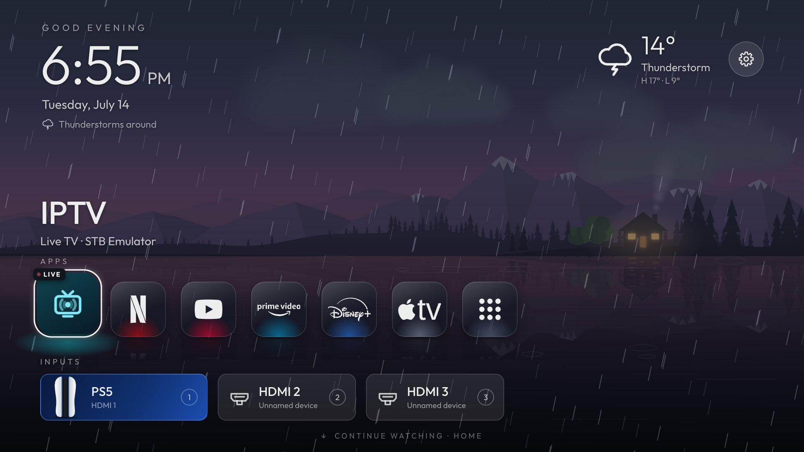
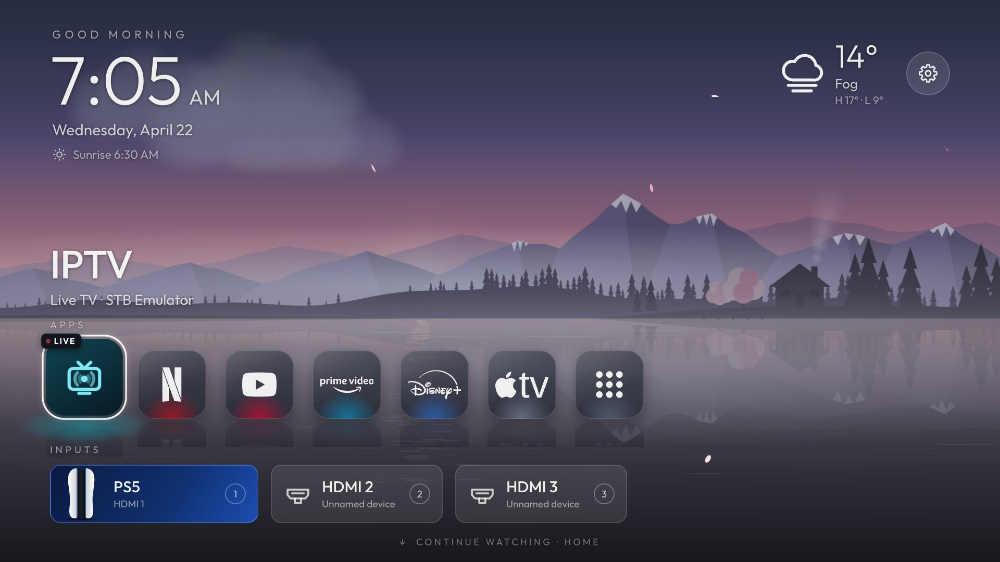
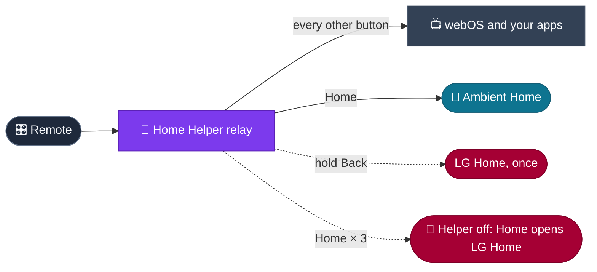
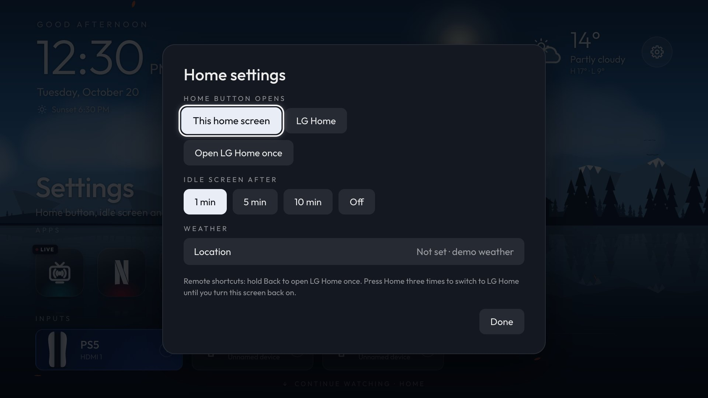

<div align="center">



# 🌄 Ambient Home

### A living lakeside home screen for LG webOS TVs


</div>

Ambient Home turns your TV's home screen into a living lakeside world that follows the real sun, moon, weather and seasons. You install it yourself in LG's Developer Mode, without rooting the TV, and the remote's Home button opens it instead of LG's home screen. Every way back to LG Home stays one press away.

> [!NOTE]
> Ambient Home is a working prototype. The home screen, opening apps and inputs, and the Home button all run on a real TV. The *Continue watching* and *Home* rows are demo designs for a media server and Home Assistant.

## ✨ Features

- 🌅 **Living wallpaper**: dawn, day, golden hour, dusk and a starry night under the real moon; clear skies, clouds, rain, thunderstorms, snow and fog; spring blossom, autumn leaves and winter snow that settles on the land; birds, shooting stars and chimney smoke. Live weather comes from [Open-Meteo](https://open-meteo.com) (free, no account) once you add your coordinates; until then it shows demo weather.
- 🧊 **Frosted-glass icons**: they rest on the lake, and on focus they lift, bloom into the app's brand colours and ripple the water. Snow caps pile up on them while it snows.
- 🎮 **Quick inputs**: number keys on the remote switch HDMI inputs, and a games-console tile plays its own launch animation.
- 📺 **Your real apps**: a script on your computer reads the TV's installed apps and inputs (read-only), so every tile opens the real thing.
- 🏠 **Home button**: the remote's Home key opens Ambient Home instead of LG's home screen, with no rooting.
- 🛟 **Always a way back**: hold Back for LG Home once, press Home three times to hand Home back to LG, or switch it in Settings.
- 🌙 **OLED-safe idle clock**: a calm clock that drifts slowly so nothing burns in.
- ⚡ **Smooth on a TV**: only position and opacity animate, and quality steps down by itself when the TV struggles. It reaches about 50 fps on a real TV, the ceiling for animated web pages there.

## 🖼️ Through the day and the year

<table>
  <tr>
    <td width="50%"><br><sub>🌕 A clear night under the real moon</sub></td>
    <td width="50%"><br><sub>❄️ Snow that settles on the land and the icons</sub></td>
  </tr>
  <tr>
    <td width="50%"><br><sub>⛈️ A thunderstorm rolling in at dusk</sub></td>
    <td width="50%"><br><sub>🌸 A foggy spring dawn</sub></td>
  </tr>
</table>

## 🏠 How the Home button works

LG doesn't let an app replace its home screen, so Ambient Home comes with **Home Helper**, a small on-TV helper from the open-source [Clean Your TV for LG webOS](https://github.com/Razdva122/clean-your-tv-lg-webos) project, reviewed and built here from source. Its relay passes every button straight through to the TV, except Home, which opens Ambient Home.



### 🛟 Ways back to LG Home

| Where | How | What happens |
| :-- | :-- | :-- |
| 🎛️ Remote | Hold **Back** for about a second | LG Home opens once |
| 🎛️ Remote | Press **Home** three times quickly | Home opens LG Home until you turn Ambient Home back on |
| ⚙️ Ambient Home | Settings → *Home button opens* → **LG Home** | Switch whenever you like |
| 💻 Computer | `scripts/tv-home.sh lg` or `scripts/tv-home.sh remove` | Switch back, or take everything off the TV |
| 🧯 Safety net | Helper stops answering, or button presses get lost | The relay lets go of the remote and turns itself off |



## 🚀 Get started

### 👀 Preview it on your computer

```bash
python3 -m http.server 8766 --bind 127.0.0.1 --directory prototype
```

Open <http://127.0.0.1:8766> and play: arrows move, Enter opens, Esc goes back. **T** changes the time of day, **W** the weather, **S** the season, **D** runs a day time-lapse, **0** shows the frame rate and **H** hides the help bar.

### 📺 Put it on your TV

You need an LG webOS TV with **Developer Mode** turned on (LG's Developer Mode app, signed in with a free LG developer account, and *Key Server* on), plus a computer on the same network with **Node.js 22+** and **Python 3**.

1. **One-time setup**: install LG's command-line tools inside the project and register your TV. The steps are at the top of [`scripts/tv-preview.sh`](scripts/tv-preview.sh).
2. **Try it as an app**: `scripts/tv-preview.sh` installs Ambient Home as a normal Developer Mode app. The Home button still opens LG Home.
3. **Bring in your apps**: run `node scripts/tv-sync-apps.mjs <TV IP>`, accept the prompt on the TV, then run step 2 again.
4. **Make it yours** (optional): put personal settings in `prototype/config.local.js`. Git ignores this file, so your coordinates and app ids never leave your computer:
   ```js
   HOME_CONFIG.weather.latitude = 48.86;   // your coordinates, for live weather
   HOME_CONFIG.weather.longitude = 2.35;
   HOME_CONFIG.apps.iptv.appId = 'your.iptv.app.id';
   ```
5. **Take over the Home button**: run `TV_HOST=<TV IP> scripts/tv-home.sh install`, then `scripts/tv-home.sh start`. The script header explains the one extra tool it needs (the Zig compiler, installed inside the project). `status`, `lg` and `remove` are there whenever you need them.

> [!TIP]
> Developer Mode sessions expire. Extend yours in LG's Developer Mode app now and then: when a session runs out, the TV removes Developer Mode apps and Home goes back to LG Home.

## 🗂️ What's inside

| Folder | What lives there |
| :-- | :-- |
| [`prototype/`](prototype) | Ambient Home itself: a web app in plain ES5, drawn for 1920×1080 |
| [`home-service/`](home-service) | Ambient Home's small on-TV service, which switches the Home button |
| [`helper/`](helper) | Home Helper, reviewed and built from source; [every change from upstream](helper/README.md) |
| [`scripts/`](scripts) | Preview, sync, build and install tools |
| [`docs/`](docs) | The screenshots above |

## 🔒 Privacy and safety

- 🔐 **No root, no firmware changes**: everything runs as Developer Mode apps that one command removes.
- 🧾 **Built from reviewed source**: Home Helper is compiled here from source; upstream's prebuilt packages are never used.
- 🧱 **Locked-down install**: both packages install root-owned files that other apps on the TV can't change.
- 🙈 **Your details stay yours**: pairing keys, your app list and `config.local.js` stay on your computer and TV, out of git.
- 🌐 **Quiet on the network**: nothing is sent anywhere except optional weather requests to Open-Meteo. Home Helper talks only to the TV itself.

## 🙏 Credits

- **Home Helper** from [Razdva122/clean-your-tv-lg-webos](https://github.com/Razdva122/clean-your-tv-lg-webos) (MIT), one of the LG webOS ports of Clean Your TV.
- [ws](https://github.com/websockets/ws) (MIT) · [Outfit](https://fonts.google.com/specimen/Outfit) font (SIL OFL 1.1) · [Simple Icons](https://simpleicons.org) (CC0) · [Lucide](https://lucide.dev) (ISC) · the Disney+ logo from Wikimedia Commons · weather by [Open-Meteo](https://open-meteo.com).
- Not affiliated with or endorsed by LG Electronics. Brand names and logos belong to their owners.

## 📄 License

[MIT](LICENSE). Bundled third-party parts keep their own licenses: [`helper/LICENSE`](helper/LICENSE), [`home-service/LICENSE`](home-service/LICENSE), [`prototype/fonts/OFL.txt`](prototype/fonts/OFL.txt) and [`prototype/icons/`](prototype/icons).

<div align="center">

**Grab a remote, press Home, and enjoy the view.** 🌲🏡🌙

</div>
